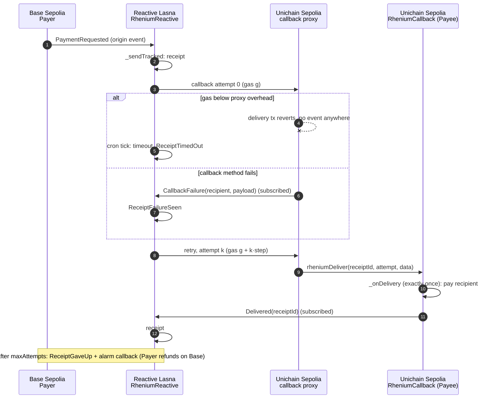

# Rhenium

**Over 10,252 callbacks requested on Reactive Lasna to Base Sepolia and Unichain Sepolia in 7 days (Nov 14–21, 2026),
289 (2.8%) emitted `CallbackFailure` on the destination proxy and were still billed, and 31 more never produced a
destination transaction. None of the 10,252 gave the requesting reactive contract any acknowledgement.**
Example failure: [Base Sepolia `0xcc65ca83…ecdc`](https://sepolia.basescan.org/tx/0xcc65ca83b89de8a8a989d7daf6ff4c8d4f6543712618ad22f7c24121225eecdc).
Method and raw data: [`research/`](research/) ([how it was measured](#how-the-number-was-measured)).

A reactive contract fires a cross-chain callback and never learns whether it landed. Reactive Network has no callback
retries and no delivery acknowledgement. **Rhenium is the delivery-confirmation and retry layer that closes that loop:**
every callback is tracked until the destination confirms it, failed or silently lost callbacks are retried with more gas,
and nothing just disappears.

* **Live dashboard:** **https://rhenium-liard.vercel.app**, a read-only receipts view reading straight from Lasna (source: [`dashboard/index.html`](dashboard/index.html))
* **Library in 10 lines:** [below](#use-the-library-in-10-lines), compiled as [`src/examples/Minimal.sol`](src/examples/Minimal.sol)
* **Video (under 3 min):** _added at submission_
* **Track:** Every Second Counts (Reactive Omni Buildathon). Rhenium is the reliability layer under time-sensitive loops:
  the demo is a cross-chain payment that actually arrives.



## For judges: start here

The same payment, sent twice with the same too-low callback gas limit (100,000). Alice pays 25 mUSD on Base Sepolia;
Bob should receive 25 mUSD on Unichain Sepolia.

| | Naive (plain `requestCallbackV_1_0`) | Rhenium (`_sendTracked`) |
|---|---|---|
| Alice pays (Base) | [`0xcadca4cc…1bb8`](https://sepolia.basescan.org/tx/0xcadca4cc4a215b3d2624fdac549a5f9280740816a5cd853f128b2588b6d11bb8) | [`0xbdb2a032…65c0`](https://sepolia.basescan.org/tx/0xbdb2a03244894bd26d60eabe93e2c8ea634d65d3b5fd6e4cb279cd53e7b865c0) |
| Reactive tx requests the payout (Lasna) | [`0x02e558a2…632e`](https://lasna.reactscan.net/tx/0x02e558a2ad3171cea7b126d83f3f1b28b766a85dc91e58ad62e0f65597f9632e) | [`0x89dba6f0…32a5`](https://lasna.reactscan.net/tx/0x89dba6f03a018435087e11d2b1469433be090c0fc717f2436f2405325f0232a5) |
| First delivery (Unichain) | [`0x93625f09…f0a5`](https://sepolia.uniscan.xyz/tx/0x93625f09f636206f9be6d73d6cc114826ceffc837ee0af41d9741565e9dff0a5): **reverted, no event** | [`0x7121be2e…6846`](https://sepolia.uniscan.xyz/tx/0x7121be2e5296cad52088111048722f69922afa8acd033990b3e95e0d92bb6846): **reverted, no event** |
| What happens next | **Nothing. Ever.** Bob is unpaid, Alice's 25 mUSD sits in escrow, no contract anywhere knows. | Timeout detected, retried at 200k → `CallbackFailure`, retried at 300k → **Bob paid**, receipt Confirmed |
| Bob's balance from this payment | 0 | 25 mUSD |

Watch it live on the [dashboard](https://rhenium-liard.vercel.app): every receipt, every attempt, every transaction link.

### The full Rhenium loop (payment #1)

| # | Step | Chain | Transaction |
|---|---|---|---|
| 1 | Origin event `PaymentRequested(1)` | Base Sepolia | [`0xbdb2a032…65c0`](https://sepolia.basescan.org/tx/0xbdb2a03244894bd26d60eabe93e2c8ea634d65d3b5fd6e4cb279cd53e7b865c0) |
| 2 | Reactive tx: receipt 1 `ReceiptSent` (attempt 0, 100k gas), cron on | Lasna | [`0x89dba6f0…32a5`](https://lasna.reactscan.net/tx/0x89dba6f03a018435087e11d2b1469433be090c0fc717f2436f2405325f0232a5) |
| 3 | Callback delivery reverts inside the proxy, **no event** | Unichain Sepolia | [`0x7121be2e…6846`](https://sepolia.uniscan.xyz/tx/0x7121be2e5296cad52088111048722f69922afa8acd033990b3e95e0d92bb6846) |
| 4 | Cron tick: `ReceiptTimedOut`, retry `ReceiptSent` (attempt 1, 200k gas) | Lasna | [`0x8146a677…adfc`](https://lasna.reactscan.net/tx/0x8146a6776d2885d744066491b7795854ee7fdf23a33d3e20f9a370ea2bc7adfc) |
| 5 | Callback method runs out of gas: `CallbackFailure` (billed) | Unichain Sepolia | [`0x4c169af3…7081`](https://sepolia.uniscan.xyz/tx/0x4c169af335f1754c9b01cc05c892250fba7afc25cda7c1edc414103c6af87081) |
| 6 | Reactive tx: `ReceiptFailureSeen`, retry `ReceiptSent` (attempt 2, 300k gas) | Lasna | [`0x64123698…8340`](https://lasna.reactscan.net/tx/0x6412369b7d2d08109bd34439660e56ac0e908490321b7aa00d810849d3f18340) |
| 7 | Callback lands: `Paid` (Bob +25 mUSD) and `Delivered(1)` | Unichain Sepolia | [`0x318b7050…5c83`](https://sepolia.uniscan.xyz/tx/0x318b70500f684941113536c7f19a79506fce07a812ffe9f676cd621587705c83) |
| 8 | Reactive tx: `ReceiptConfirmed`, cron off (nothing pending, nothing billed) | Lasna | [`0xa3326503…aa6d`](https://lasna.reactscan.net/tx/0xa33265034c6a70ac7dc36d3cda3c3a4b8dad51e5ecfb6e78d6400b06fa1baa6d) |

Five more live loops (payments #2–#6, Base origin txs
[`0x538fecd6`](https://sepolia.basescan.org/tx/0x538fecd60426ff75f1c5d670b21c3f30cef7432dbf35bce9c9a73f0dbf22faa6),
[`0xea7af1a7`](https://sepolia.basescan.org/tx/0xea7af1a7785136a16607cbf84d068d4e932759a36bc2d46dfc3680bc8a726854),
[`0x57de353f`](https://sepolia.basescan.org/tx/0x57de353f73202852bb101fd71c0eae0677f45c7c78d61847473f213ed986d6ba),
[`0xdfcd66f3`](https://sepolia.basescan.org/tx/0xdfcd66f360df63bcca76ecfd27380723af692b0c49fe4ce13bf37ac2fbc769dc),
[`0xbd76952e`](https://sepolia.basescan.org/tx/0xbd76952ef5993953878c13cdf7d72e7d11db87beded03dd548a1e61f1b626f3b))
followed the same path; all their hashes are on the dashboard and in [`research/data/loops2-6.txt`](research/data/loops2-6.txt).

### Latency (median of 6 live loops)

| Measured | Median | Clock |
|---|---|---|
| Payment requested on Base → Bob paid on Unichain | **32 s** | Base vs Unichain |
| Failure detected → delivered on Unichain | **5 s** | Lasna vs Unichain |
| Failure detected → receipt Confirmed | 4 s | Lasna only |
| Successful attempt round trip (Lasna → Unichain → Lasna) | 2 s | Lasna only |
| Payment requested → failure detected | 27 s | Base vs Lasna |

The 27 s is the configured timeout (20 Lasna blocks, checked on Cron10 ticks); it only applies to the silent-revert
case, which leaves no event to react to. A `CallbackFailure` is reacted to in about 2 s. Lasna's block clock was
observed 1–3 s ahead of Base and Unichain, so mixed-clock rows carry that skew.
Per-loop data: [`research/data/latency.json`](research/data/latency.json), produced by [`research/latency.py`](research/latency.py).

### Deployed contracts

| Contract | Chain | Address |
|---|---|---|
| `RheniumPaymentReactive` | Reactive Lasna (5318007) | [`0x6Df4d0d5983d79e4f5489f6f1406CEE8Cfa7EeFb`](https://lasna.reactscan.net/address/0x6Df4d0d5983d79e4f5489f6f1406CEE8Cfa7EeFb) |
| `NaivePaymentReactive` | Reactive Lasna | [`0xfa23E6063cA72f60ee55234eC8A068Ea0f1803E5`](https://lasna.reactscan.net/address/0xfa23E6063cA72f60ee55234eC8A068Ea0f1803E5) |
| `Payer` (Rhenium; alarm target) | Base Sepolia (84532) | [`0xB03DEd797CEca3689B282C8378890905A17cBA04`](https://sepolia.basescan.org/address/0xB03DEd797CEca3689B282C8378890905A17cBA04) |
| `Payer` (naive) | Base Sepolia | [`0x0C7321e15B7644175Ec02C8Df26F0F944A746163`](https://sepolia.basescan.org/address/0x0C7321e15B7644175Ec02C8Df26F0F944A746163) |
| `MockUSD` | Base Sepolia | [`0x62459CBBab8a0541946FeA91aA1bdeAb618E69B5`](https://sepolia.basescan.org/address/0x62459CBBab8a0541946FeA91aA1bdeAb618E69B5) |
| `RheniumPayee` | Unichain Sepolia (1301) | [`0xfa23E6063cA72f60ee55234eC8A068Ea0f1803E5`](https://sepolia.uniscan.xyz/address/0xfa23E6063cA72f60ee55234eC8A068Ea0f1803E5) |
| `NaivePayee` | Unichain Sepolia | [`0x59Df6195853ee36514baDf5C43F599e4Ba4DC3CE`](https://sepolia.uniscan.xyz/address/0x59Df6195853ee36514baDf5C43F599e4Ba4DC3CE) |
| `MockUSD` | Unichain Sepolia | [`0xEd1BA791f8842e3f88913cf1f52855927F04C42a`](https://sepolia.uniscan.xyz/address/0xEd1BA791f8842e3f88913cf1f52855927F04C42a) |

The same deployer was used on every chain, so a few addresses repeat across chains (for example `0xfa23…03E5` is the
naive reactive contract on Lasna and the Rhenium payee on Unichain). They are unrelated contracts. All addresses and
link txs: [`deployments/demo.env`](deployments/demo.env). Spike contracts: [`docs/spike-report.md`](docs/spike-report.md).

## Use the library in 10 lines

```solidity
// Reactive Lasna: inherit RheniumReactive instead of AbstractReactive
contract MyReactive is RheniumReactive {
    constructor(Config memory c) payable RheniumReactive(c) {}
    function _react(LogRecord calldata log_) internal override {          // your subscriptions arrive here
        _sendTracked(1301, myCallback, 200_000, abi.encode(log_.topic1)); // instead of requestCallbackV_1_0
    }
}
// Destination chain: inherit RheniumCallback instead of AbstractCallback
contract MyCallback is RheniumCallback {
    constructor(IPayable proxy, address reactive) payable RheniumCallback(proxy, reactive) {}
    function _onDelivery(uint256 receiptId, bytes calldata data) internal override { /* your action */ }
}
```

`Delivered(receiptId)` is emitted for you; revert in `_onDelivery` to signal failure. Config
(`src/RheniumReactive.sol`): `maxAttempts`, `gasStep`, `maxGasLimit`, `cooldownBlocks`, `timeoutBlocks`,
`cronTopic` (Cron10 / Cron100 / Cron1000), `cronEnabled`, and an optional alarm `(chainId, recipient, gasLimit)`.
Hooks: `_onConfirmed(receiptId)`, `_onGaveUp(receiptId)`, `_onAlarm(...)`. Deployment order: reactive contract first,
then the callback contract with the reactive's address, then link (the first `_sendTracked` to a recipient subscribes to
its acknowledgements automatically; `watch(chainId, recipient)` does it up front).

What it does for you:

* **Receipts.** `_sendTracked` assigns a `receiptId`, stores `{chainId, recipient, gasLimit, attempts, status, firstBlock, data}`
  and threads `receiptId` and `attempt` through a fixed `rheniumDeliver(address rvm, uint256 receiptId, uint256 attempt, bytes data)`
  ABI (the first slot is the one the proxy overwrites with the reactive contract's address).
* **Two failure detectors.** A subscription to the destination proxy's `CallbackFailure`, filtered to the recipient
  (reacts in about 2 s), **and** a cron timeout for deliveries that revert inside the proxy and leave no log at all.
  The spike showed the second case is real: [`docs/spike-report.md`](docs/spike-report.md#s2--s3-failure-detection-and-retry-pass-with-an-important-finding).
* **Retry policy.** Each retry adds `gasStep` (capped at `maxGasLimit`), respects a per-receipt cooldown, and after
  `maxAttempts` marks the receipt Failed, emits `ReceiptGaveUp` and sends one alarm callback. Never silent.
* **Exactly-once on the destination.** A timeout retry can race a slow original delivery; `RheniumCallback` executes
  once per `receiptId` and re-acknowledges duplicates. For payments, Bob cannot be paid twice.
* **Cron only while needed.** Cron bills every tick (we measured ~0.02 REACT per Cron10 tick), so Rhenium subscribes
  when the first receipt becomes pending and unsubscribes on the first tick with nothing pending.

Tests: `forge test` runs 41 tests (33 library, 5 demo end-to-end, 3 spike), including a fuzzed gas schedule, the
cooldown, cron subscribe/unsubscribe on empty and refill, stale and foreign failure events, the deployment-order
linkage, `onlyServiceProvider` / `onlyCallbackSender` on both callback entry points, exactly-once delivery and the
timeout-vs-late-delivery race. The mocks reproduce both failure modes observed live.

## What Reactive can't do today, and what Rhenium adds

Feedback for the Reactive team, from building this. Quotes are from [dev.reactive.network](https://dev.reactive.network) (Nov 2026).

| The docs say | What we observed | What Rhenium adds |
|---|---|---|
| `requestCallbackV_1_0()` returns nothing; delivery happens later on another chain. | The requesting contract has no on-chain way to learn the outcome. | `Delivered(receiptId)` acknowledgement, subscribed by the requester. |
| "A failed callback still costs you. The proxy charges after the call regardless of the outcome, so a reverting callback method burns gas, emits `CallbackFailure`, and bills you for the attempt." | Confirmed: each `CallbackFailure` attempt was billed; 289 such failures in 7 days. | Reacts to `CallbackFailure` within ~2 s and retries with more gas. |
| "Gas limits are set on the reactive side, so a callback contract that keeps failing may need the reactive contract to request a higher `gasLimit`" (Debugging). | There is no automatic retry anywhere; the fix described is a redeploy. | Automatic retry with a stepped gas limit, ceiling and cooldown. |
| A gas limit "too low to cover that overhead fails with `InsufficientGas` before your method runs". | **That failure emits no `CallbackFailure`**: the delivery transaction itself reverts and leaves no log anywhere ([spike tx](https://sepolia.basescan.org/tx/0x8ab982bab1e858ec9d5c819ea871c105ad5c213ce6b51cc1f9138a412b9ed420)). A contract watching `CallbackFailure` waits forever. | Cron-timeout detection. |
| `getCallbacks(reactiveTxHash)` on the system contract returns delivery records with the destination tx hash and error. | Returned an empty array for 40 of 40 sampled requests, including ones 6 hours old. | Receipts the contract and dashboard can actually read. |
| `rnk_getFilters` response fields `version` / `topicFilters`. | Live response uses `Version` / `TopicFilters`. | (Dashboard accepts both.) |

Suggested protocol features: a delivery-status event the requester can subscribe to (success and failure, including
`InsufficientGas`), and an optional retry policy on `requestCallback`.

## How the number was measured

[`research/measure.py`](research/measure.py), public JSON-RPC only:

* **Requested:** `CallbackRequest` events from the Lasna system contract `0x8888…8888`, grouped by destination chain.
* **Delivery attempts:** every delivery on a destination chain is a transaction from one Reactive signer
  (`0xf7e866…1ddb`) to the callback proxy; the change in that signer's nonce over the window is the attempt count
  (cross-checked against a block scan).
* **Failures:** `CallbackFailure(address indexed recipient, bytes payload)` logs on the proxies
  (Base Sepolia `0x476F…3585`, Unichain Sepolia `0x775c…66C1`).
* Window 2026-11-14T22:10Z → 2026-11-21T22:10Z, ending 2 h before measurement so every request had time to land.
  Raw data: [`research/data/measure_20261122T0010Z.json`](research/data/measure_20261122T0010Z.json).

| Destination | Requested | Delivery attempts | `CallbackFailure` | No destination tx |
|---|---|---|---|---|
| Base Sepolia | 6,805 | 6,792 | 233 (37 recipients) | 13 |
| Unichain Sepolia | 3,447 | 3,429 | 56 (17 recipients) | 18 |
| Ethereum Sepolia | 897 | not measured | – | – |

Caveats: 289 is a lower bound (deliveries that revert inside the proxy emit nothing); "no destination tx" is a net
difference and may include requests in flight at the window edges; failures are concentrated (one Base recipient
accounts for 126 of 233). A separate 24 h scan of every Unichain Sepolia delivery
([`research/reverted.py`](research/reverted.py)) found 1,030 deliveries, 13 `CallbackFailure`, and 0 silent reverts:
silent reverts are a real failure mode (we trigger it on purpose in the demo) but rare in current traffic.

## Repository

```
src/RheniumReactive.sol      library: receipts, detection, retry, cron gating
src/RheniumCallback.sol      library: destination base, exactly-once, Delivered
src/IRhenium.sol             fixed ABI + events
src/demo/                    MockUSD, Payer, Payees, NaivePaymentReactive, RheniumPaymentReactive
src/spike/                   Step 1 spike contracts
test/                        Foundry tests (mocks in test/utils)
dashboard/index.html         read-only live dashboard (no build step)
script/demo.sh, spike.sh     deploy / pay / balances
research/                    measurement, watcher and latency scripts + raw data
docs/spike-report.md         Step 1 spike with tx hashes
```

Run it yourself: install [Foundry](https://getfoundry.sh), `git clone --recursive`, `forge test`. To deploy your own
copy, put a **testnet** key in `.env` (see `script/demo.sh` for the variables), fund it on Lasna, Base Sepolia and
Unichain Sepolia, then `script/demo.sh deploy` and `script/demo.sh pay rhenium 100000`.

## Limits

* **Cron costs REACT while anything is pending** (~0.02 REACT per Cron10 tick, measured). Rhenium only subscribes while
  receipts are pending; Cron100 is ~10× cheaper but detects silent failures ~10× slower. With `cronEnabled = false` only
  `CallbackFailure` failures are detected.
* **Gas-step ceiling.** Retries stop at `maxGasLimit`; a callback that reverts for logic reasons (not gas) will use all
  attempts and then give up with an alarm.
* **The alarm is fire-once** and not itself tracked.
* **One acknowledgement per destination contract.** Subscriptions are per `(chain, recipient)`; each `RheniumCallback`
  trusts exactly one reactive contract (immutable, as in `AbstractCallback`).
* **The timeout scan is bounded** to 8 receipts per tick (round-robin), so with many pending receipts detection slows.
* **Demo escrow is not settled.** On success the Base escrow stays in the Payer (there is no liquidity-provider
  settlement); it is only released on give-up (refund).
* **Measurement:** Ethereum Sepolia deliveries were not measured (its RPCs were unreachable during Step 0); the Base
  silent-revert scan was not run.
* **Testnet only.** No mainnet deployment, no audit, no real funds.
